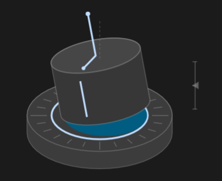
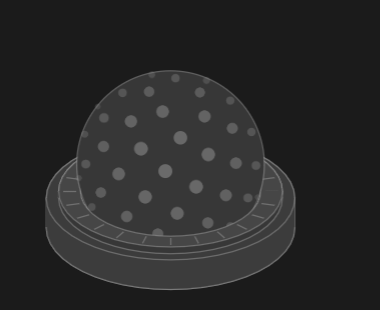

# 3D mouse visualizer

A picture of a 3D mouse for [egui](https://github.com/emilk/egui) that moves the way the real device does. It covers the two kinds people use: a cap that springs back to the middle when you let go, and a trackball with a scroll ring. Both are drawn in code at the angle you'd see the device from your chair, so you can see every axis at once.

I built it for the calibration window in [SolidCraft](https://github.com/tangency-labs/solidcraft), where it shows each motion the calibration asks for and then follows your device once it's calibrated. It's useful anywhere you want to show what a 3D mouse is doing: a settings page, a calibration or test tool, or just checking that a device works.

| Cap | Trackball |
| --- | --- |
|  |  |

## What it shows

Each motion has its own marker, and a marker lights in the theme's accent colour while that motion is active.

On the cap:

- **Twist**: the groove down the front of the cap and the pointer on its top turn against the ticks on the base.
- **Tilt**: a mast stands on the cap's axis and leans away from a dashed upright that marks where it rests.
- **Slide**: the ring the cap rests in stays put on the base, so you can see the cap leave it.
- **Pull up and press down**: a gauge beside the device rises and falls, and the lit gap under the cap widens or closes.

On the trackball:

- **Roll and spin**: dots spread evenly over the ball slide across it as it turns.
- **Scroll ring**: notches on the ring turn with it.

A trackball reports how fast it's moving rather than where it is, so the ball and the ring keep their turn between frames instead of springing back.

Colours come from the egui theme, so it works in light and dark mode.

## Using it

```toml
[dependencies]
mouse3d-visualizer = { git = "https://github.com/nomadsgalaxy/3d-mouse-visualizer", default-features = false }
```

Readings are on six axes (X, Y, Z, Rx, Ry, Rz), each ±1 at full deflection: slid right is +X, pulled toward you is +Y, pressed down is +Z, tilted back is +Rx, tilted left is +Ry and twisted clockwise is +Rz.

A cap:

```rust
let (rect, _) = ui.allocate_exact_size(egui::vec2(200.0, 150.0), egui::Sense::hover());
let moving = travel.map(|v| v.abs() > 0.1);
mouse3d_visualizer::paint(ui, rect, &mouse3d_visualizer::Pose::new(travel), moving);
```

A trackball keeps its own state, so hold on to a `Ball` and roll it every frame:

```rust
use mouse3d_visualizer::{ball, ball_rate};

let rate = ball_rate(travel);
self.ball.roll(rate, ui.input(|i| i.stable_dt));
ball::paint(ui, rect, &self.ball, rate[..3].iter().any(|v| v.abs() > 0.1), rate[3].abs() > 0.1);
```

`demo_swing` gives a gentle out-and-back motion that starts from rest, which is handy for showing someone what to do with the device.

## The demo

```sh
cargo run --release
```

It opens a window with the picture and a panel to drive it: sliders for each axis, a walk through each motion the way a calibration asks for them, or your own device read live. Switch between the cap and the trackball, light and dark, and change the size.

Reading a device needs Linux and read access to its `/dev/hidraw*` node (a udev rule with `TAG+="uaccess"` does it). It finds the first HID multi-axis controller and divides its raw axes by 350 with no calibration, so an axis may run the wrong way: there's an invert box per axis for that. Build with `--no-default-features` to leave device reading out; it uses the `solidcraft-space-mouse` crate for the HID descriptors.

## Licence

MIT, see [LICENSE](LICENSE). The shapes are generic and aren't modelled on any manufacturer's device. Product names such as SpaceMouse belong to their owners; this project isn't affiliated with them.
